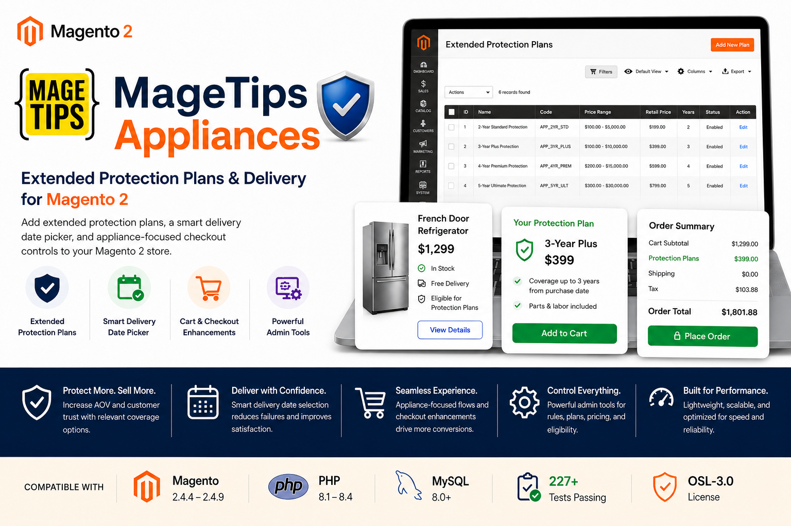
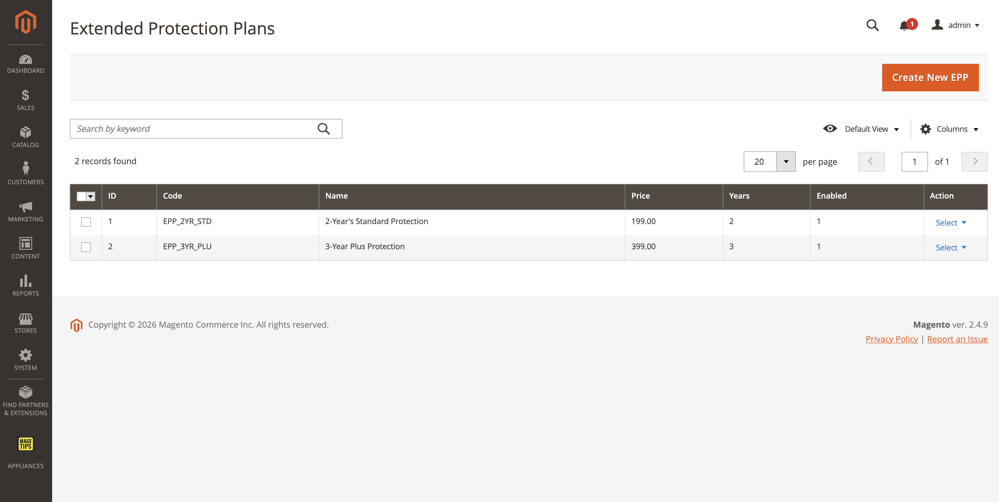
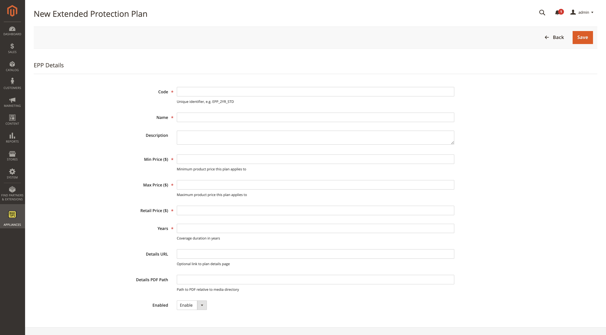
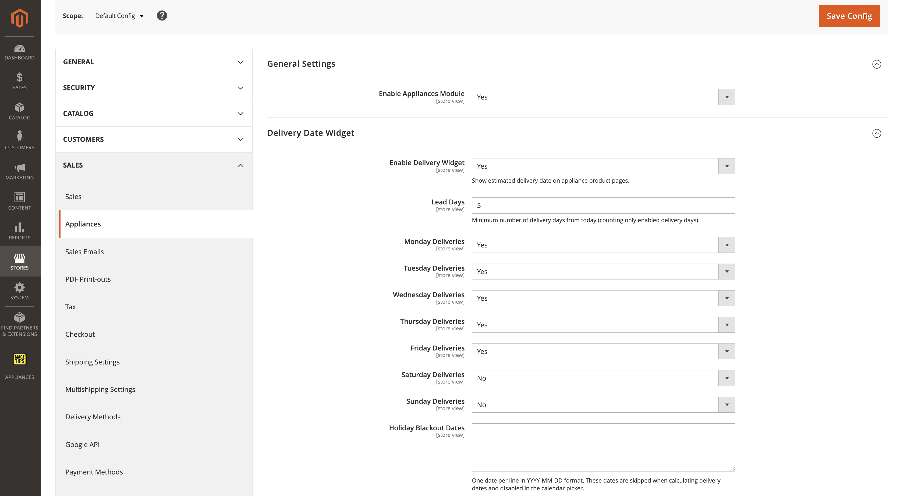
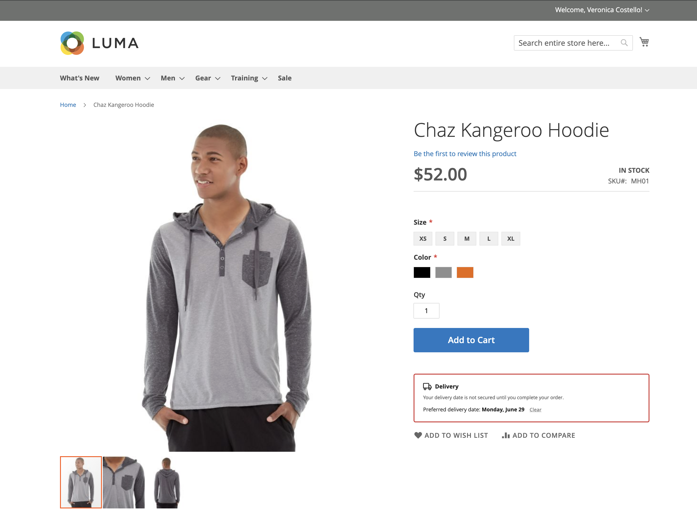
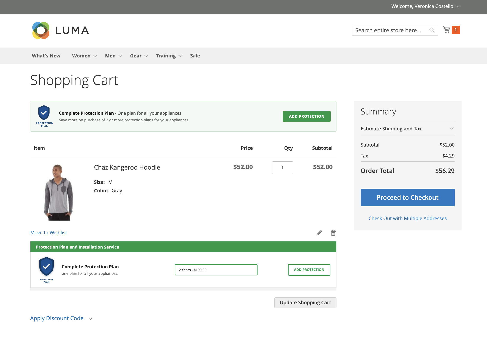
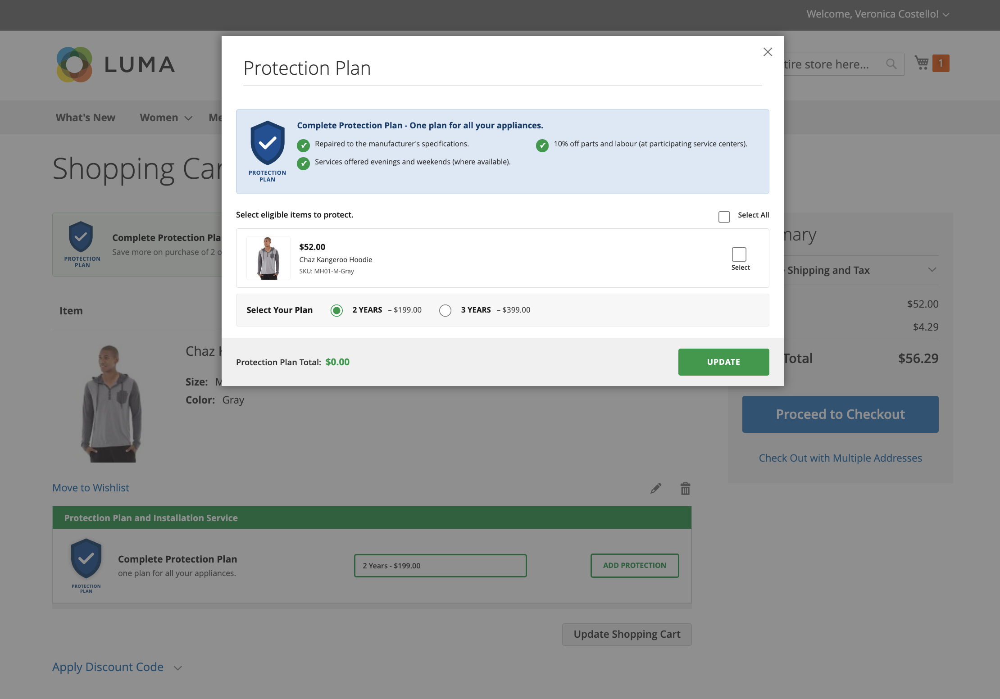
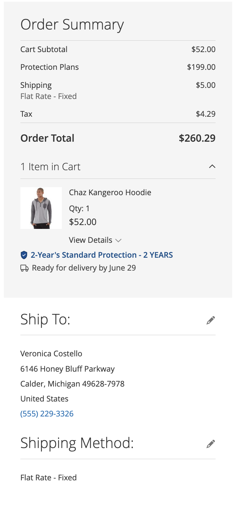

# MageTips Appliances — Extended Protection Plans & Delivery for Magento 2

[](https://magento.com)
[](https://www.php.net)
[](LICENSE)
[](https://github.com/UmarShaikh79/magento2-appliances/releases)
[](#testing)



Sell appliances with confidence. This module adds **Extended Protection Plans (EPP)**, a smart **delivery date picker**, and appliance-specific checkout controls to your Magento 2 store — all configurable from the admin panel without any code changes.

> 📦 Install with one command: `composer require magetips/module-appliances`
> Also available on the **Adobe Commerce Marketplace** *(listing in review)*.

---

## Table of Contents

- [Features](#features)
- [Screenshots](#screenshots)
- [Compatibility](#compatibility)
- [Requirements](#requirements)
- [Installation](#installation)
- [Configuration](#configuration)
- [How It Works](#how-it-works)
- [Admin Management](#admin-management)
- [Database Schema](#database-schema)
- [Admin Roles (ACL)](#admin-roles-acl)
- [Testing](#testing)
- [Upgrade](#upgrade)
- [Uninstall](#uninstall)
- [Contributing](#contributing)
- [Support](#support)
- [License](#license)

---

## Features

### Extended Protection Plans
- Create and manage protection plans with flexible **price-band pricing** — plans automatically qualify for products within a configured price range
- Full **CRUD admin grid** with search, sort, filters, and inline actions
- **Bulk CSV import** to create or update plans in one upload
- Per-item **price range validation** — plans can only be applied to eligible products, enforced at both UI and controller level
- EPP charges tracked through **cart → checkout → order → invoice → credit memo**
- Two **default plans** seeded on install (2-Year Standard, 3-Year Plus)

### Delivery Date Widget
- Smart **calendar picker** on every appliance product page with configurable lead days
- Set available delivery days per weekday (Monday–Sunday) and block **holiday blackout dates**
- Earliest eligible date pre-selected on page load — customers can checkout immediately
- Delivery date saved per cart item and surfaced in the **checkout sidebar**
- Configurable **headline text** with `{date}` placeholder and optional sub-text

### Cart & Checkout
- **Protection Plan summary bar** above cart items with one-click plan management
- **Multi-item modal** — select a plan and apply it to one or all appliance items at once
- Live **Protection Plans total** line in cart and checkout order summary
- EPP plan name and delivery date displayed as **badges in the checkout sidebar**

### Admin & Orders
- **Stores > Configuration > Sales > Appliances** — enable/disable module features per store view
- Upload a custom **protection plan icon** (PNG, JPG, SVG, WebP) used across cart and checkout UI
- EPP charge and delivery date visible on **admin order, invoice, and credit memo** views
- EPP plan details included in **transactional order emails**
- Full **ACL support** — control which admin roles can manage plans and configuration

---

## Screenshots

### Admin — EPP Plans Grid


### Admin — Create / Edit Plan


### Admin — Configuration


### Frontend — Delivery Date on Product Page


### Frontend — Cart Protection Plan Bar


### Frontend — Plan Selection Modal


### Frontend — Checkout Order Summary


---

## Compatibility

| Component | Version |
|-----------|---------|
| Magento Open Source / Adobe Commerce | 2.4.4 – 2.4.9 |
| PHP | 8.1, 8.2, 8.3, 8.4, 8.5 |
| MySQL | 8.0+ |
| Composer | 2.x |

---

## Requirements

The following Magento core modules must be enabled (all present in a standard Magento installation):

- `magento/framework` ^103.0
- `magento/module-backend` ^102.0
- `magento/module-catalog` ^104.0
- `magento/module-eav` ^102.0
- `magento/module-sales` ^103.0
- `magento/module-quote` ^101.0
- `magento/module-checkout` ^100.0
- `magento/module-config` ^101.0
- `magento/module-ui` ^101.0
- `magento/module-import-export` ^101.0

---

## Installation

### Via Composer *(recommended)*

```bash
composer require magetips/module-appliances
php bin/magento module:enable MageTips_Appliances
php bin/magento setup:upgrade
php bin/magento setup:di:compile
php bin/magento setup:static-content:deploy -f
php bin/magento cache:clean
```

### Manual Installation

1. Download or clone this repository
2. Copy the contents to `app/code/MageTips/Appliances/`
3. Run the commands above starting from `module:enable`

After installation, two default EPP plans are created automatically:

| Code | Name | Price Range | Retail Price | Years |
|------|------|-------------|--------------|-------|
| `EPP_2YR_STD` | 2-Year Standard Protection | $100 – $5,000 | $199 | 2 |
| `EPP_3YR_PLU` | 3-Year Plus Protection | $100 – $10,000 | $399 | 3 |

These are starting points — edit or delete them freely from **Appliances > Extended Protection Plans**.

---

## Configuration

Navigate to **Stores > Configuration > Sales > Appliances**.

### General Settings

| Field | Description |
|-------|-------------|
| Enable Appliances Module | Master on/off switch for all module features |

### Extended Protection Plan (EPP)

| Field | Description |
|-------|-------------|
| Protection Plan Icon | Upload a custom icon (PNG, JPG, SVG, WebP). Defaults to a blue shield SVG if left empty |
| Protection Plan Box Title | The green header label shown above each item's EPP box on the cart page |
| Manage Modal Title | Title of the plan-selection popup (e.g. "Choose Your Protection Plan") |

### Delivery Date Widget

| Field | Description |
|-------|-------------|
| Enable Delivery Widget | Show the date picker on appliance product pages |
| Lead Days | Minimum days from today before the earliest delivery date (counting enabled delivery days only) |
| Monday – Sunday | Toggle each weekday available for delivery (Yes/No per day) |
| Holiday Blackout Dates | One date per line in `YYYY-MM-DD` format — these dates are skipped and disabled in the picker |
| Headline Text | Text shown above the date. Use `{date}` as a placeholder, e.g. `Earliest delivery: {date}` |
| Sub-text | Optional HTML allowed below the headline |

---

## How It Works

1. **Mark products as appliances** using the `is_appliance` product attribute (set to *Yes* in the product edit form under the **Appliances** attribute set)
2. **Create EPP plans** under **Appliances > Extended Protection Plans** — set a price range so each plan only applies to products within that range
3. Customers visiting an appliance product page see the **delivery date widget** and can optionally pick their preferred date
4. On the **cart page** a Protection Plan bar appears — customers click **Add Protection** to open the plan modal and select coverage for one or all appliance items at once
5. The chosen plan and delivery date appear as line items in the **checkout order summary**
6. EPP charges flow through to **orders, invoices, and credit memos** automatically
7. EPP details and delivery dates are included in **transactional order confirmation emails**

---

## Admin Management

### Extended Protection Plans Grid

Navigate to **Appliances > Extended Protection Plans** in the admin sidebar.

- **Add New Plan** — opens the create/edit form
- **Edit / Delete** — inline actions on each row
- **Bulk Actions** — delete multiple plans at once via the mass-action dropdown
- **Search & Filter** — filter by code, name, price range, years, or status

### EPP Plan Fields

| Field | Required | Notes |
|-------|----------|-------|
| Code | Yes | Unique identifier, e.g. `EPP_3YR_PLU`. Used internally and stored on quote/order items |
| Name | Yes | Customer-facing plan name shown in cart and checkout |
| Description | No | Internal description |
| Min Price | Yes | Minimum product price this plan covers |
| Max Price | Yes | Maximum product price this plan covers |
| Retail Price | Yes | Price charged to the customer for this plan |
| Years | Yes | Coverage duration in years |
| Details URL | No | Link to a plan details page |
| Enabled | Yes | Disable a plan without deleting it |

### Bulk CSV Import

1. Prepare a CSV with columns matching the plan fields above (`code`, `name`, `min_price`, `max_price`, `retail_price`, `years`, `enabled`, etc.)
2. Navigate to **System > Import** and select entity type **EPP Plans**
3. Upload the CSV — existing plans (matched by `code`) are updated; new codes are inserted

---

## Database Schema

The module creates one new table and extends two existing Magento tables.

### New table: `appliances_epp`

Stores EPP plan definitions.

| Column | Type | Notes |
|--------|------|-------|
| `entity_id` | INT (PK, auto-increment) | |
| `code` | VARCHAR(50) | Unique plan identifier |
| `name` | VARCHAR(255) | Display name |
| `description` | TEXT | Optional |
| `min_price` | DECIMAL(10,2) | Lower bound of product price range |
| `max_price` | DECIMAL(10,2) | Upper bound of product price range |
| `retail_price` | DECIMAL(10,2) | Price charged to customer |
| `years` | INT | Coverage years |
| `details_url` | VARCHAR(500) | Optional link |
| `details_pdf_path` | VARCHAR(500) | Optional PDF path |
| `enabled` | SMALLINT | 1 = active |
| `created_at` | TIMESTAMP | Auto-set on insert |
| `updated_at` | TIMESTAMP | Auto-updated |

**Indexes:** `code` (unique), `enabled` (btree), `(min_price, max_price)` (btree)

### Extended table: `quote_item`

| Column | Type | Notes |
|--------|------|-------|
| `delivery_date` | DATE | Customer-selected delivery date |
| `epp_plan_code` | VARCHAR(50) | Selected plan code |
| `epp_plan_name` | VARCHAR(255) | Plan name at time of selection |
| `epp_plan_price` | DECIMAL(10,2) | Plan price at time of selection |
| `epp_plan_years` | SMALLINT | Coverage years |

### Extended table: `sales_order_item`

Same five columns as `quote_item` above — values are copied from the quote item when the order is placed.

---

## Admin Roles (ACL)

The module registers the following ACL resources under **Admin > Appliances**:

| Resource ID | Label | Use |
|-------------|-------|-----|
| `MageTips_Appliances::appliances` | Appliances | Parent resource |
| `MageTips_Appliances::appliances_epp` | Manage EPP Plans | Access to the plans grid and form |
| `MageTips_Appliances::appliances_config` | Configuration | Access to Stores > Configuration > Appliances |

Assign these resources to admin roles under **System > User Roles**.

---

## Testing

The module ships with a PHPUnit test suite covering models, controllers, plugins, observers, and UI components.

The module ships with a PHPUnit 12 test suite. To run it, create a `phpunit.xml` in the module root that bootstraps Magento's unit test framework:

```xml
<?xml version="1.0" encoding="UTF-8"?>
<phpunit bootstrap="../../../../dev/tests/unit/framework/bootstrap.php" colors="true">
    <source>
        <include><directory suffix=".php">.</directory></include>
        <exclude><directory>./Test</directory></exclude>
    </source>
    <testsuites>
        <testsuite name="MageTips_Appliances_Unit_Tests">
            <directory>./Test/Unit</directory>
        </testsuite>
    </testsuites>
    <php>
        <ini name="memory_limit" value="-1"/>
        <ini name="date.timezone" value="America/Los_Angeles"/>
    </php>
</phpunit>
```

### Run Unit Tests

```bash
# From the Magento root
php vendor/bin/phpunit --configuration app/code/MageTips/Appliances/phpunit.xml
```

### Run with Code Coverage (requires pcov or Xdebug)

```bash
# Install pcov for PHP 8.3 (one-time)
CPPFLAGS="-I/opt/homebrew/include" pecl install pcov

# Run with line coverage report
php -d opcache.enable_cli=0 \
    -d pcov.directory=app/code/MageTips/Appliances \
    -d memory_limit=512M \
    vendor/bin/phpunit \
    --configuration app/code/MageTips/Appliances/phpunit.xml \
    --coverage-text
```

### Test Suite Summary

| Metric | Value |
|--------|-------|
| Test cases | 227 |
| Assertions | 487 |
| PHP versions tested | 8.1, 8.3, 8.4 |
| PHPUnit version | 12.x |

> **Note:** PHPUnit 12 removed `MockBuilder::addMethods()`. All mocks in this suite use `onlyMethods()` with `__call` callbacks for Magento's magic DataObject getters — compatible with PHPUnit 12.x.

---

## Upgrade

```bash
composer update magetips/module-appliances
php bin/magento setup:upgrade
php bin/magento setup:di:compile
php bin/magento setup:static-content:deploy -f
php bin/magento cache:clean
```

---

## Uninstall

```bash
php bin/magento module:disable MageTips_Appliances
php bin/magento setup:upgrade
composer remove magetips/module-appliances
```

To also remove the database changes:

```bash
php bin/magento setup:db-schema:upgrade --dry-run  # preview first
```

> **Warning:** Removing the module drops the `appliances_epp` table and removes the five added columns from `quote_item` and `sales_order_item`. Back up your database before proceeding.

---

## Contributing

Contributions are welcome. If you've found a bug or have an idea:

1. Open an [issue](https://github.com/UmarShaikh79/magento2-appliances/issues) describing the problem or proposal
2. Fork the repo and create a feature branch
3. Keep changes aligned with the Magento 2 coding standard (`phpcs --standard=Magento2`) and add unit tests where it makes sense
4. Open a pull request referencing the issue

If this module saved you time, a ⭐ on the repo is genuinely appreciated — it helps other merchants find it.

---

## Support

- **Issues & Bug Reports:** [GitHub Issues](https://github.com/UmarShaikh79/magento2-appliances/issues)
- **Email:** umarshiekh619@gmail.com

---

## License

This module is released under the [Open Software License 3.0 (OSL-3.0)](LICENSE).

Copyright © 2026 Muhammad Umar
